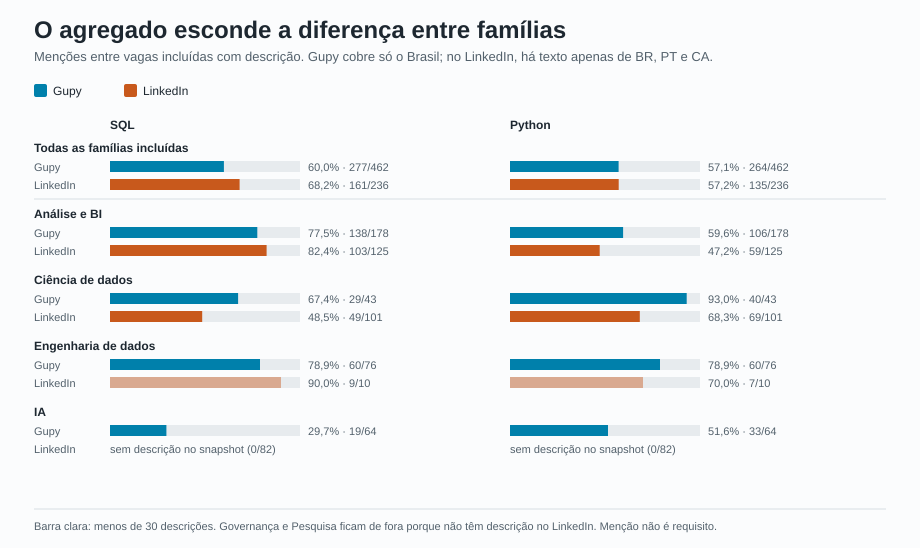

# Mapa de vagas de dados

O que as vagas de dados pedem? Para responder, analisei anúncios da Gupy, do LinkedIn e do [RemoteOK](https://remoteok.com), coletados em setembro e outubro de 2026. Este repositório guarda as regras de classificação, as figuras e as tabelas com os totais.

A base tem 2.822 anúncios. Depois da classificação pelo título, 1.719 contam como vagas de dados.

## O que encontrei

SQL, Python e Power BI são as competências mais citadas nas três fontes. O peso de cada uma muda com a família de cargo, o grupo em que cada vaga foi classificada. Na Gupy, que tem descrição em todas as vagas:

- **Análise e BI:** SQL lidera (77,5% contra 59,6% de Python).
- **Ciência de dados:** Python lidera (93,0% contra 67,4% de SQL).
- **Engenharia de dados:** cita os dois na mesma medida (78,9% cada).

A comparação entre fontes engana. Python aparece em 57,1% das descrições da Gupy e em 57,2% das do LinkedIn, mas o empate some ao separar por família de cargo. Só 236 das 1.209 vagas incluídas do LinkedIn têm descrição, e 226 delas são de análise e BI ou ciência de dados.



"Citada" quer dizer que a palavra aparece no texto do anúncio. Pode ser requisito, diferencial ou tecnologia do time.

## O que tem aqui

| Arquivo | O que é |
|---|---|
| [`harmonizar.py`](harmonizar.py) | Regras únicas para classificar as três fontes por família, senioridade e competências, com os testes dessas regras |
| [`validar_amostra.py`](validar_amostra.py) | Seleção da amostra de 26 itens usada para revisar as regras |
| [`gerar_figuras.py`](gerar_figuras.py) | Gera as figuras a partir das tabelas |
| [`harmonizado/relatorio-harmonizacao-2026-10-30.md`](harmonizado/relatorio-harmonizacao-2026-10-30.md) | Critérios usados e contagens por fonte |
| [`harmonizado/figuras/`](harmonizado/figuras/) | Quatro figuras em SVG e as tabelas com os totais em CSV |

## O que não tem aqui

A base linha a linha, os arquivos de coleta, os coletores e a amostra de validação não são públicos. Os termos de uso do LinkedIn e da Gupy restringem copiar e distribuir esse conteúdo.

Por isso, `harmonizar.py` e `validar_amostra.py` servem para ler as regras e só rodam por inteiro com os dados. Com o que está neste repositório, dá para rodar os testes das regras e gerar as figuras.

## Como rodar

Você só precisa de Python 3. Os comandos usam a biblioteca padrão e não acessam a internet.

```bash
python3 -c "import harmonizar; harmonizar.validar(); print('regras ok')"
python3 gerar_figuras.py
```

## Limites

- A base não mede o mercado de dados. São três fontes com coberturas diferentes.
- A classificação usa o título do anúncio, e parte das descrições está cortada.
- A mesma vaga pode aparecer em mais de uma plataforma, porque não houve deduplicação semântica entre elas, ou seja, nenhuma etapa identificou anúncios iguais com IDs diferentes.
- No RemoteOK, o país é um palpite do coletor em parte dos registros. Estar num canal remoto também não confirma o tipo de contrato nem quem pode se candidatar.

## Autoria

Feito com Claude Code. Eu dirigi o projeto e tomei as decisões de classificação. A coleta da Gupy, a harmonização, as figuras e o rascunho deste texto foram feitos com a ferramenta. Na minha escala de uso de IA, este texto é N3: rascunho da IA, editado por mim linha a linha.

## Licença

O código está sob a [licença MIT](LICENSE). As figuras, as tabelas e os textos estão sob [CC BY 4.0](https://creativecommons.org/licenses/by/4.0/deed.pt-br).
